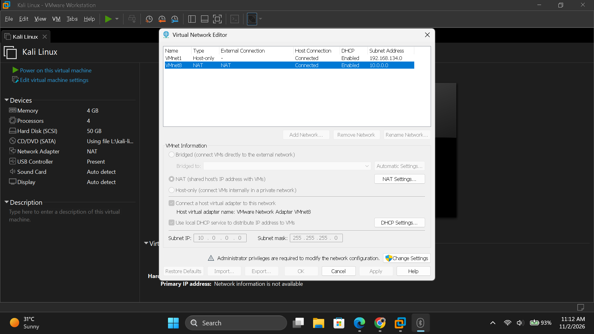
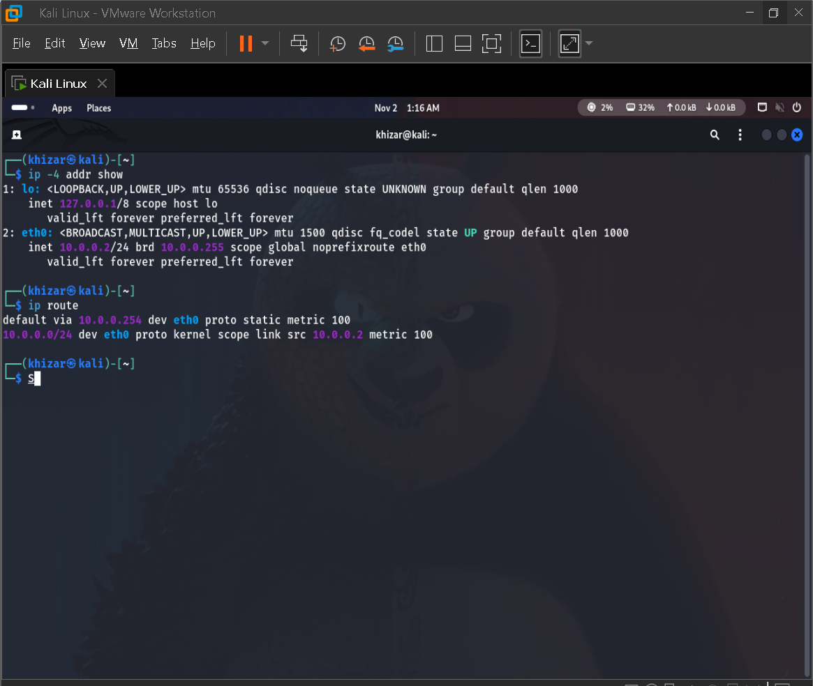
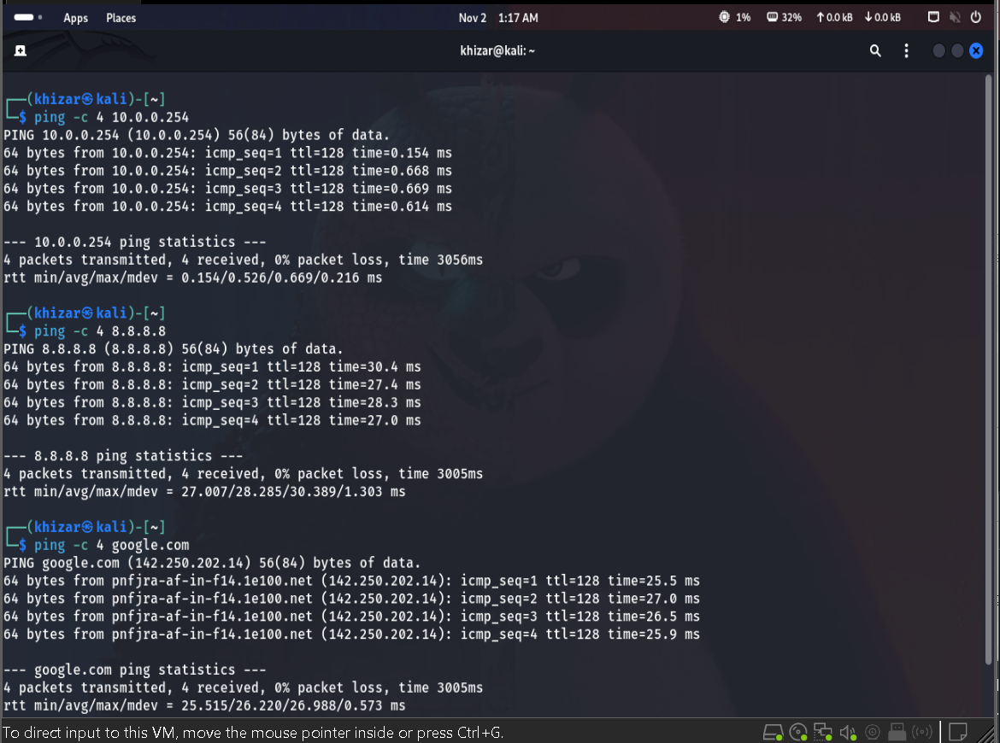
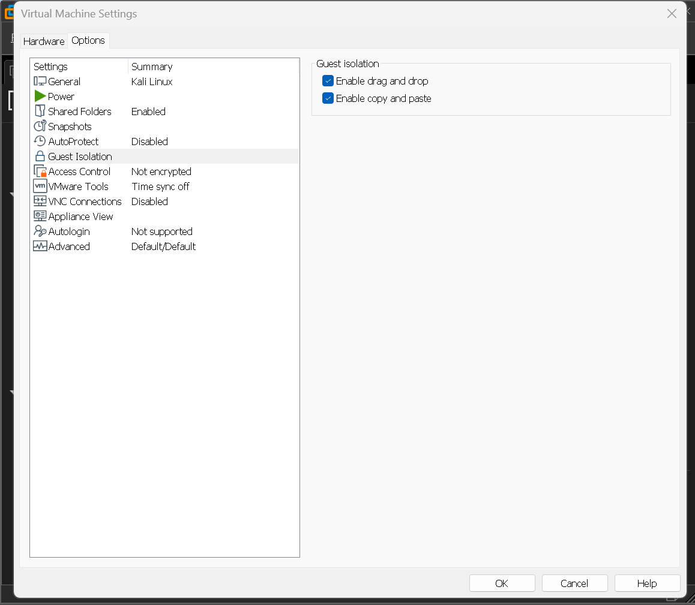
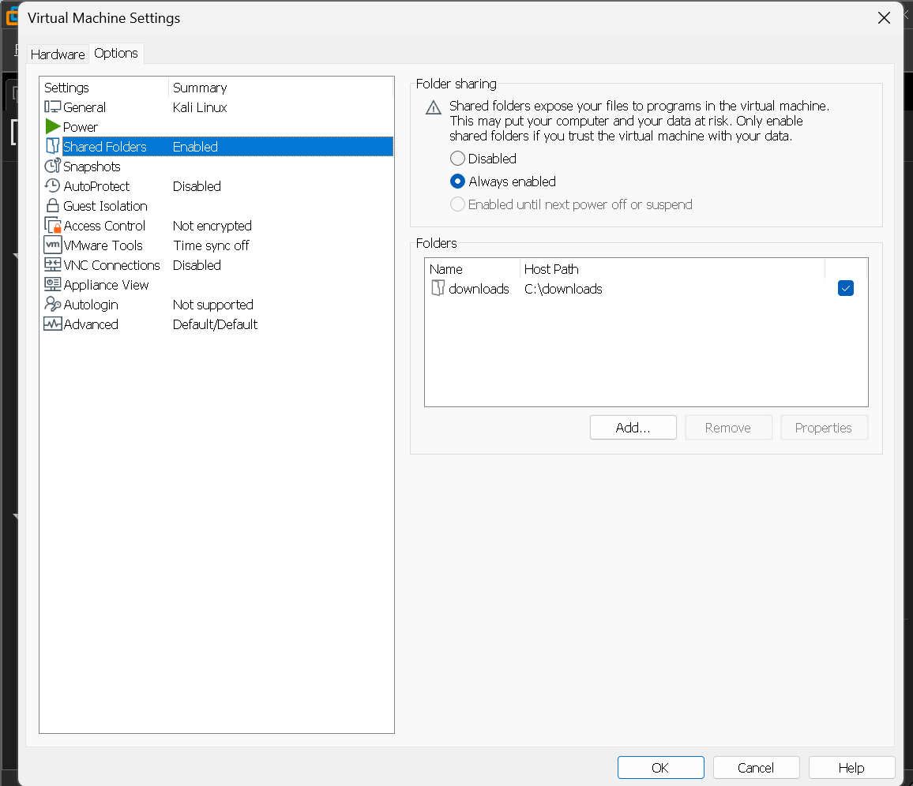
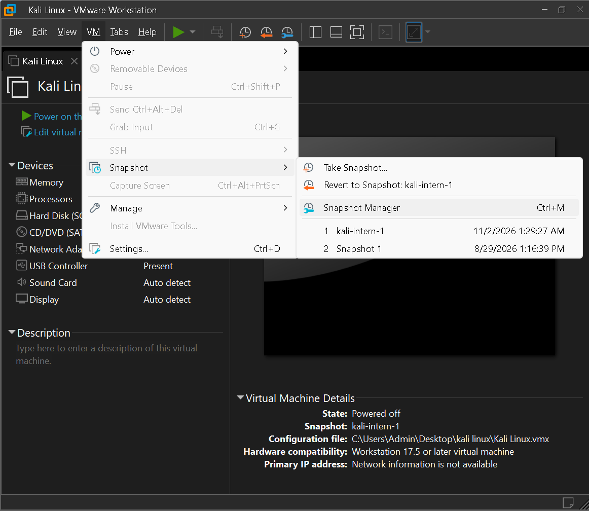

# Cybersecurity Lab Setup – Week 1, Project Module 1

## Overview

This project involved setting up a Kali Linux virtual machine for a basic cybersecurity lab environment. The lab was configured using VMware Workstation Pro.

## Tools Used

* VMware Workstation Pro
* Kali Linux
* 7-Zip
* Windows 11

## Lab Configuration

### 1. Virtual Network

* Network type: NAT
* Virtual network: VMnet8
* Subnet: `10.0.0.0/24`
* Kali Linux IP address: `10.0.0.2/24`
* Gateway: `10.0.0.254`
* DNS: `8.8.8.8`

### 2. Kali Linux Setup

Kali Linux was configured with a static IP address. Internet and DNS connectivity were tested.

### 3. Clipboard and Drag-and-Drop

Clipboard sharing and drag-and-drop were enabled in VMware settings to support file and text transfer between Windows and Kali Linux.

### 4. Shared Folder

A folder named `downloads` was created on the Windows host at `C:\downloads` and shared with Kali Linux.

The shared folder was accessed in Kali Linux at:

`/mnt/hgfs/downloads`

A test text file was used to verify that the shared folder was accessible through both the terminal and the graphical file manager.

### 5. Snapshot

A snapshot of the configured Kali Linux virtual machine was created to preserve the lab setup.

## Screenshots

### 1. VMware VMnet8 Network Configuration

### 2. Kali Linux IP Configuration

### 3. Internet and DNS Connectivity Test

### 4. Clipboard and Drag-and-Drop Settings

### 5. VMware Shared Folder Settings

### 6. Shared Folder Visible in Kali Linux File Manager

### 7. Snapshot Created

## What I Learned

* Basics of virtual machine networking
* Difference between NAT networking and other virtual network modes
* Static IP configuration in Kali Linux
* Shared folder setup between host and virtual machine
* Clipboard sharing and drag-and-drop
* Accessing shared folders through the Linux filesystem and GUI
* Creating snapshots for virtual machine recovery

## Troubleshooting

During the setup, the VMware shared folder was detected but was not initially visible in the Kali Linux graphical file manager.

The shared folder was mounted at `/mnt/hgfs` using VMware's shared-folder utility. After mounting, the `downloads` folder became accessible through the graphical file manager, and a test file was used to verify access.

## Note

The assignment reference specifies VirtualBox. This lab was completed using VMware Workstation Pro as an alternative. 

